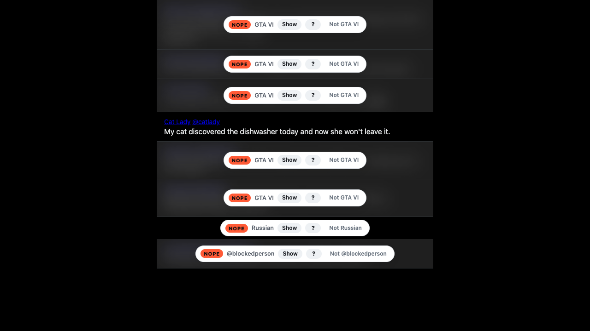
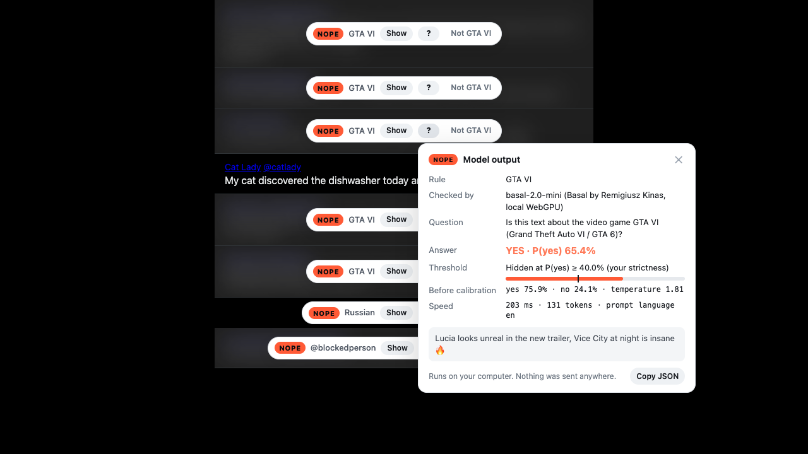
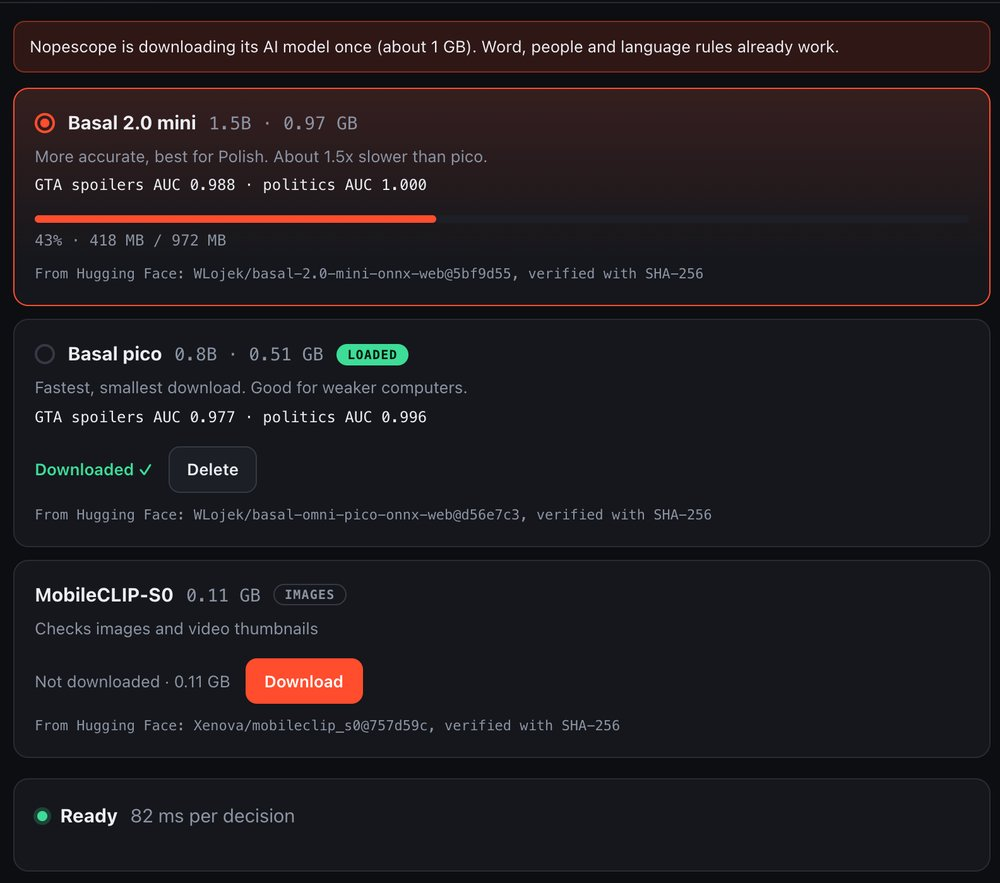
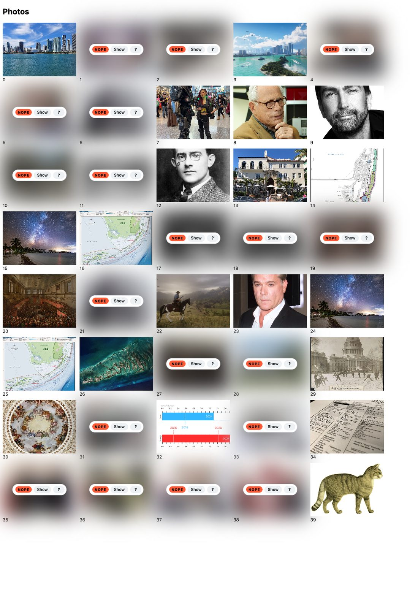

# Nopescope

**Say nope to topics, people and languages on any website.** Nopescope is a Chrome extension with one rulebook for the whole web. A small AI model running on your own GPU hides matching posts, comments, paragraphs, images and pages before you read them. Nothing you browse leaves your computer.

<p align="center">
  
</p>

- **Rules for anything you want to stop seeing:**
  - **Topics** in plain words, in any language ("Donald Trump", "crypto", "GTA VI"). A local model decides these.
  - **Words**, matched as whole words.
  - **People and channels**: @handles, u/names, channel names.
  - **Languages**: hide some, or show only some.
- **Freedom over where rules apply.** Nopescope as a whole runs on *all sites*, *only these sites* or *all sites except these*, and every rule has its own scope too.
- **Works on every website:**
  - Dedicated detection for X, YouTube, Reddit and Google Search.
  - Automatic detection of posts, comments, cards and paragraphs everywhere else.
  - If a whole page is about a topic, it gets a curtain.
- **Images and video thumbnails** are checked too, by their pixels (MobileCLIP) and by the words around them.
- **You can always see why.** Every hidden item has a **?** button that shows the model output: the rule, the question the model was asked, P(yes) against your threshold, the raw scores and the text it read.
- **Private by design.** The models download once from Hugging Face (pinned to a commit, SHA-256 checked) and then run on your GPU through WebGPU. There are no servers, accounts, telemetry or API calls, and nothing you browse is ever sent anywhere.

<p align="center">
  
</p>

## How it works

```
page ──▶ content script ──▶ service worker ──▶ offscreen document (WebGPU)
         finds items         routes, stats       Basal (text): one yes/no decision per topic rule
         word / author /                         MobileCLIP (images): zero-shot match
         language rules                          ▲ models: downloaded once from Hugging Face
         ◀──────────── verdicts + model output ──┘
```

1. A **site adapter** turns the page into items: a post, a comment, a video tile, a search result or a paragraph.
2. **Cheap rules** run first, in the page: words, authors, and languages via Chrome's on-device language detector.
3. **Topic rules** go to a [Basal](https://github.com/rkinas/basal) decision model by Remigiusz Kinas. The model reads the item and answers a typed question, such as *"Is this text about Donald Tusk?"*. It returns a calibrated probability in a single forward pass and never generates text. The runtime that runs Basal in the browser is [basal-web](basal-web/): ONNX int4 on onnxruntime-web, following Basal's own [format-2 contract](https://github.com/rkinas/basal/blob/main/docs/FORMAT2.md).
4. **Images and video posters** are matched by MobileCLIP-S0 against what each topic looks like (*"a photo of politicians"*), and their alt text and captions go through Basal.
5. **Items above your threshold** get blurred or collapsed. Items are classified nearest to the viewport first, and only within a few screens.

More detail: [docs/ARCHITECTURE.md](docs/ARCHITECTURE.md).

## Models

| Model | Size | Speed (M4 Pro) | GTA VI spoilers, AUC | Politics, AUC |
|---|---|---|---|---|
| **Basal 2.0 mini** (1.5B, Bielik-based), default, [HF](https://huggingface.co/WLojek/basal-2.0-mini-onnx-web) | 0.97 GB | ~110–200 ms / decision | 0.988 | 1.000 |
| **Basal pico** (0.8B, Qwen3.5-based), [HF](https://huggingface.co/WLojek/basal-omni-pico-onnx-web) | 0.51 GB | ~80–130 ms / decision | 0.977 | 0.996 |
| **MobileCLIP-S0**, images, [HF](https://huggingface.co/Xenova/mobileclip_s0) | 0.11 GB | – | n/a | n/a |

<p align="center"></p>

You switch the text model in the settings. Each model downloads once from Hugging Face, pinned to an exact commit, and every file is checked against its SHA-256 before use. The scores are for the browser int4 builds, on synthetic eval sets. GTA VI is not out yet, so its "spoilers" are invented. Full numbers and how to reproduce them are in [docs/EVAL.md](docs/EVAL.md).

## Install

**From a release:**
1. Download `nopescope-<version>.zip` from [Releases](https://github.com/WLojek/nopescope/releases) (about 7 MB) and unzip it.
2. Open `chrome://extensions`, turn on **Developer mode**, click **Load unpacked** and pick the folder.
3. On first run, the rulebook opens and the models download once: about 1.1 GB for Basal 2.0 mini plus MobileCLIP. Word, people and language rules work right away.

**Requirements:**
- Chrome 124 or newer. Other Chromium browsers are untested.
- WebGPU, for topic rules. Without it, word, author and language rules still work.
- About 1.1 GB of disk space for the models (0.6 GB with pico).

## Build from source

```bash
cd extension
npm install
npm run build          # -> extension/dist (load it unpacked; the models download on first run)
npm test               # rule matching + site adapters
npm run package        # -> nopescope-<version>.zip
```

The browser tests (`npm run test:e2e` and the others in `extension/test/`) serve the models from `models-web/` instead of downloading them on every run. `test/hf-download.mjs` checks the real first run from Hugging Face.

**Reproduce the model files:**

```bash
# Python 3.10+; needs torch, transformers==5.17.0, onnx, onnxruntime-genai>=0.19, huggingface_hub
python basal-web/scripts/export.py Remek/basal-2.0-mini  models-web/basal-2.0-mini
python basal-web/scripts/export.py Remek/basal-omni-pico models-web/pico
python basal-web/scripts/export.py Xenova/mobileclip_s0  models-web/mobileclip-s0
```

The export is deterministic for a given builder version. Compare the SHA-256 of your files with `extension/src/shared/models.js`.

## Using it

- **Rules:** the toolbar popup adds a topic in one line ("everywhere" or "only on this site") and shows what was hidden today. The rulebook page holds the rest: packs, rules with per-rule sites, strictness sliders for text and images, the site scope, the text model, and feedback export.
- **Show** reveals an item for the rest of the page.
- **Not …** reveals it and records a local label, which you can export as JSON to tune thresholds or fine-tune a model.
- **Packs:** *GTA VI* (everything about the game; on by default for the launch), *No politics*, *Less doom*.

<p align="center">
  
</p>

## Limitations

- **Topics are judged per item.** Very short items (a three-word reply) give the model little to go on.
- **The image model recognises a style or a scene, not identities.** It knows "a photo of a politician", but it confuses one politician with another. It can tell "GTA-like art" from photos, but not GTA VI from GTA V.
- **Native apps are out of reach.** It works in Chrome on desktop. Mobile apps and desktop apps like the Instagram or TikTok apps are not covered; their websites are.
- **Site markup changes.** The dedicated adapters for X, YouTube, Reddit and Google follow those sites' markup, which changes over time. The generic adapter is the fallback.

## Project layout

| Path | What |
|---|---|
| [`extension/`](extension/) | the Chrome extension (MV3) |
| [`basal-web/`](basal-web/) | the browser runtime for Basal decision models, usable on its own |
| [`eval/`](eval/) | eval sets and scripts |
| [`docs/`](docs/) | architecture, eval results, store listing |

## Credits

- **Basal** decision models: [Remigiusz Kinas](https://github.com/rkinas/basal), Apache-2.0. They are built on Bielik (SpeakLeash) and Qwen3.5.
- **MobileCLIP**: Apple, via Xenova's ONNX conversion. Its weights are under Apple's own model license; Nopescope downloads them from Hugging Face and does not redistribute them. See [NOTICE](NOTICE).
- **onnxruntime-web** (Microsoft, MIT) and **tokenizers.js** (Hugging Face, Apache-2.0).

## License

[Apache-2.0](LICENSE). The model weights keep their own licenses; see [NOTICE](NOTICE). Privacy: [PRIVACY.md](PRIVACY.md).
